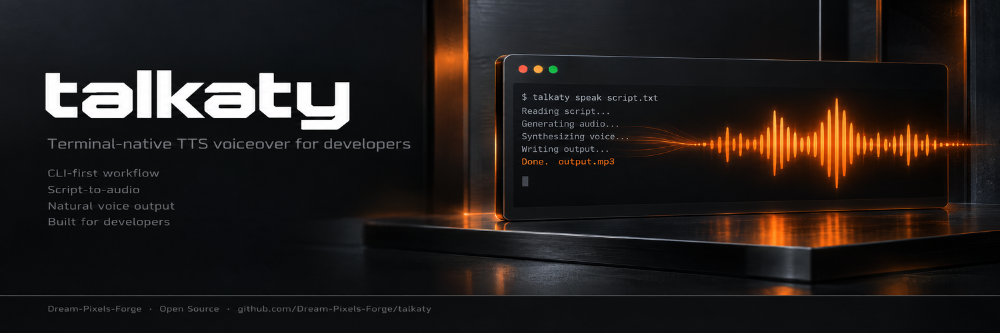

# talkaty

<div align="center">
  
</div>



Terminal-native TTS voiceover tool. Turn a `script.md` (plus optional brief) into polished voiceover audio in any accent, using open-source TTS backends. Exposes both a CLI and an MCP stdio server for coding agents.

[](https://pypi.org/project/talkaty/)
[](LICENSE)
[](https://www.python.org/)
[](https://github.com/Dream-Pixels-Forge/talkaty/actions/workflows/ci.yml)

---

## Install

```bash
# Default (edge-tts backend, 400+ voices, no API key)
pip install talkaty

# With local offline fallback backends
pip install talkaty[kittentts]
pip install talkaty[piper]

# Editable install from source
git clone https://github.com/Dream-Pixels-Forge/talkaty.git
cd talkaty
pip install -e .[dev]
```

## Quick start

```bash
# Generate voiceover from script.md (default: smooth female, US, edge-tts)
talkaty generate script.md

# Choose a persona and accent
talkaty generate script.md --voice "alpha male" --accent US

# Pitch, speed, and subtitles
talkaty generate script.md --pitch 2 --speed 1.2 --subtitles

# Brief-driven accent auto-selection (brief mentions "Nigerian" → NG voice)
talkaty generate script.md --brief brief.txt

# Preview a short sample (no script file needed)
talkaty preview "Hello world" --voice "alpha male"

# Batch a directory of scripts
talkaty batch scripts/ out/

# List available personas/voices
talkaty voices
```

## Personas

| Persona | Description | Accent |
|---------|-------------|--------|
| alpha male | Bold, authoritative male voice | US |
| smooth female | Warm, friendly female voice | US |
| warm narrator | Storytelling female voice | UK |
| energetic | High-energy voice for ads/hype | US |
| calm | Calm male voice for meditation/ASMR | AU |
| nigerian narrator | Nigerian English storytelling voice | NG |
| french narrator | French storytelling voice | FR |
| chinese narrator | Mandarin Chinese storytelling voice | ZH |
| narrator | Deep, mysterious storyteller for documentaries | US |
| deep french narrator | Deep, mysterious French storyteller for documentaries | FR |
| hindi narrator | Hindi storytelling voice | HI |
| spanish narrator | Spanish storytelling voice | ES |
| german narrator | German storytelling voice | DE |

## Backends

| Backend | Install | Notes |
|---------|---------|-------|
| edge-tts (default) | `pip install talkaty` | 400+ voices, many accents, free, no API key |
| kittenTTS | `pip install talkaty[kittentts]` | Local, offline fallback |
| piper | `pip install talkaty[piper]` | Local, offline backend using `.onnx` voice models |

## MCP

talkaty runs as an MCP stdio server exposing `tts_generate`, `list_voices`, `list_personas`, and `preview`. Connect it to any MCP-compatible coding agent to generate voiceover from within your agent loop.

Example MCP call (`tts_generate`):
```json
{
  "script_path": "script.md",
  "brief_path": "brief.txt",
  "voice": "smooth female",
  "accent": "US",
  "backend": "edge-tts"
}
```

## Outputs

- Audio: MP3 (default), WAV
- Subtitles: SRT, VTT (via `--subtitles`)
- Metadata: sidecar `.json` with voice, backend, duration, settings

## SSML-lite markup

Add fine-grained control inside `script.md` with SSML-lite tags:

| Tag | Effect |
|-----|--------|
| `<break time='1s'/>` | Pause for 1 second (also `500ms`, `2s`) |
| `<emphasis>text</emphasis>` | Emphasize text (pitch boost) |
| `<pitch>+2</pitch>` | Set pitch in semitones for following text (negative = deeper) |

Example:
```markdown
Hello.<break time='1s'/> <emphasis>Listen closely</emphasis> now.
<pitch>+2</pitch>This is higher pitched.
<pitch>-2</pitch>This is deeper.
```

## CI

`mypy`, `ruff`, `ruff format`, and `pytest` run on every push/PR via GitHub Actions. Releases are published to PyPI via trusted publishing on new `v*` tags.

## License

MIT — see [LICENSE](LICENSE).
